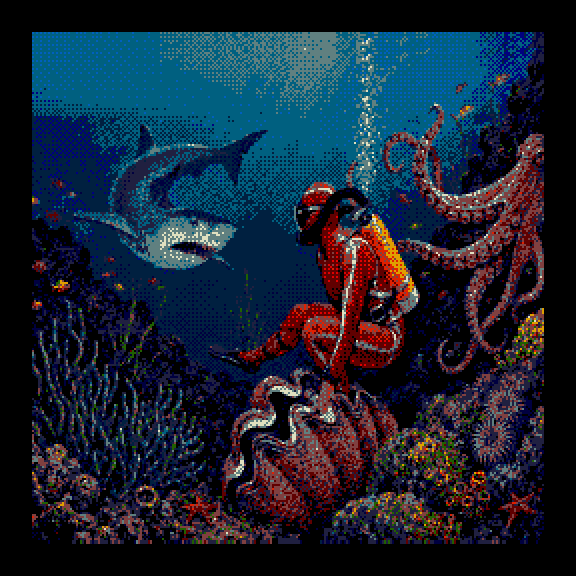
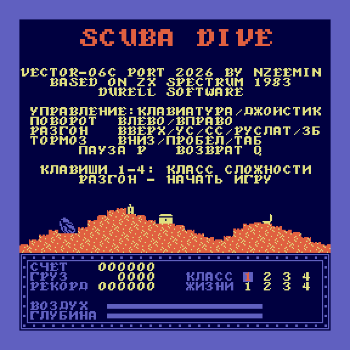
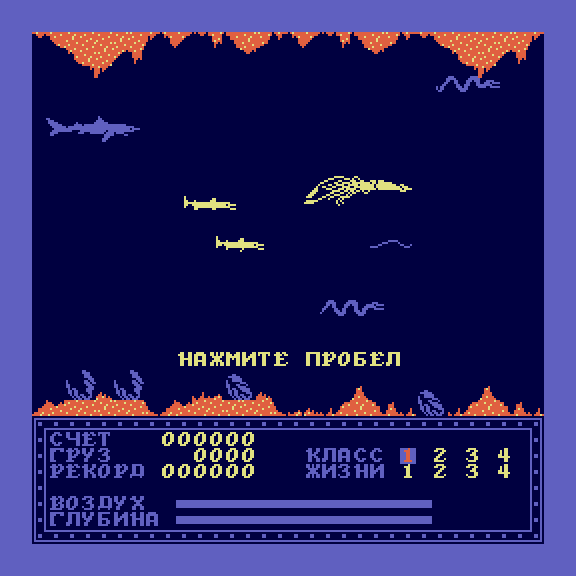
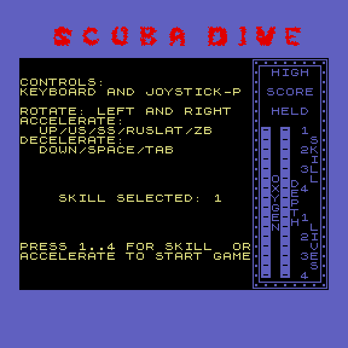
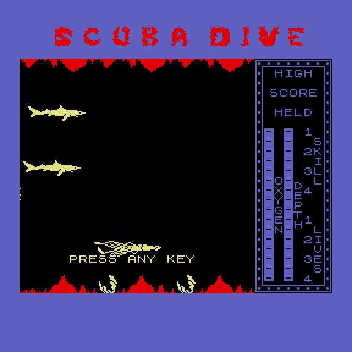
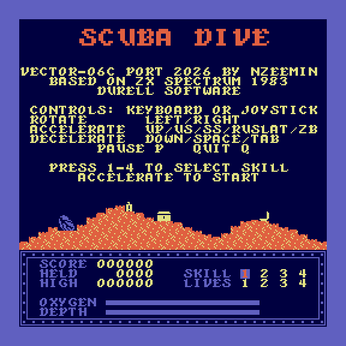
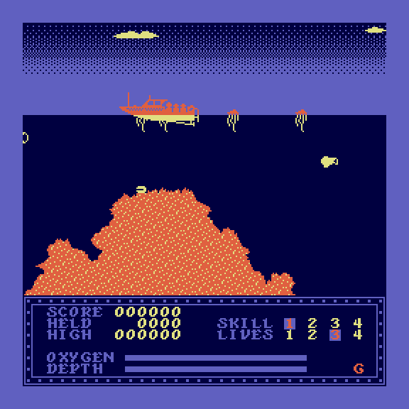

# Scuba Dive «i8080 DX» для ванильного Вектора-06Ц (i8080 + ВИ53)

> **Имена версий** (владелец, 2026-09-15): эта сборка — **«i8080 DX»**; порт
> Зимина, пропущенный через наш транслятор под i8080, зовётся просто
> **«i8080»** (`tools/build_zimin.sh`), а его исходная версия под плату Z80 —
> «Z80». На карте MiSTer лежат ровно эти три образа.

Порт игры **Scuba Dive** (Durell Software, 1983, ZX Spectrum) на Вектор-06Ц
**без** платы Z80 и без квазидиска: штатный КР580ВМ80А (i8080) на 3 МГц, 64 КБ,
звук на таймере КР580ВИ53. Основа — Z80-порт nzeemin
([vector06c-scubadive](https://github.com/nzeemin/vector06c-scubadive), см.
`src/README-nzeemin.md`): графика, разметка памяти и структура кода взяты оттуда,
переведены на i8080 и затем существенно переработаны ради скорости и памяти.

> **Репозиторий** (с 19.10.2026): github.com/reqw41/scubadive-dx-v06c. Ветка `main` —
> эта версия; её история начинается с коммитов Зимина (последний — 0611be8), на них
> лежит наша. Ветка `nzeemin8080` — порт Зимина с минимальными правками для
> ванильного Вектора: звук через ВИ53, перевод на i8080, джойстик «П»
> (готовый образ `rom/scuba-nzeemin8080.rom` в той ветке).

| Заставка (DX) | Меню (DX) | Под водой (DX, демо) |
|---|---|---|
|  |  |  |

| Меню (порт Зимина, `nzeemin8080`) | Под водой (порт Зимина, демо) |
|---|---|
|  |  |

| Меню (DX, английская) | Игра (DX, английская, режим бога — красная G) |
|---|---|
|  |  |

## Готовые образы

| Файл | Что это |
|---|---|
| [`rom/scuba-dx-splash.rom`](rom/scuba-dx-splash.rom) | «i8080 DX» с заставкой и маршем Men of Harlech, 65280 Б — для MiSTer и эмуляторов |
| [`rom/scuba-dx.rom`](rom/scuba-dx.rom) | «i8080 DX» без заставки, грузится с 0x0100 |
| [`rom/scuba-dx-en-splash.rom`](rom/scuba-dx-en-splash.rom) | «i8080 DX» на английском, с заставкой и маршем |
| [`rom/scuba-dx-en.rom`](rom/scuba-dx-en.rom) | «i8080 DX» на английском, без заставки |
| [`rom/scuba-nzeemin8080.rom`](rom/scuba-nzeemin8080.rom) | порт Зимина под i8080: звук через ВИ53, джойстик «П» (ветка `nzeemin8080`), на английском |

## Язык

«i8080 DX» переведён на русский: меню и подписи панели («СЧЕТ», «ГРУЗ», «РЕКОРД»,
«ВОЗДУХ», «ГЛУБИНА», «КЛАСС», «ЖИЗНИ»), «НАЖМИТЕ ПРОБЕЛ». Кириллица лежит в свободных
ячейках шрифта игры, генератор — `tools/rus.py`. Язык выбирается флагом сборки `RUS`:
по умолчанию `RUS=1` (русский), `RUS=0` — английский, язык оригинала ZX Spectrum, со
строками ZX-версии. Метка режима бога в панели — красная «Б» в русской сборке и «G»
в английской.

```sh
RUS=0 tools/build_prod.sh build/en/prod                 # английская игра
RUS=0 BUILD_DIR=build/en tools/splash/build_splash.sh   # английская с заставкой
```

Все пять пересобирает `tools/build_roms.sh` (порт Зимина — из ветки `nzeemin8080`
её же `build.sh`). Управление везде: клавиатура и джойстик «П».

Игровая логика **тождественна оригиналу**: каждая сборка сверяется потиково с
Z80-эталоном Зимина (`tools/verify/lockstep.js`, семь сценариев) — состояния
игры совпадают тик в тик.

## Сборка

```sh
# игра (образ .rom, грузится с 0x0100). Боевой набор флагов — внутри скрипта.
tools/build_prod.sh build/prod

# игра + заставка (splash-ROM, 65280 Б): внутрь кладётся та же боевая сборка
tools/splash/build_splash.sh
#   -> build/prod/scuba_splash.rom
```

```sh
# кассета: WAV для магнитофона Вектора (внутри — заставка и игра)
python3 tools/cas/make_cas.py
#   -> build/cas/scuba_kaseta.wav (53 с)
```

Нужны sjasmplus и salvador (ZX0), python3, node ≥ 18 (стенд). Оба инструмента
вложены в `tools/bin/`, но это сборка **под macOS arm64**; на другой машине
поставьте свои ([sjasmplus](https://github.com/z00m128/sjasmplus) 1.24,
[salvador](https://github.com/emmanuel-marty/salvador)) и передайте пути:
`SJASMPLUS=sjasmplus SALVADOR=salvador tools/build_prod.sh build/prod` — так же
для `tools/splash/build_splash.sh`, `tools/build_roms.sh` и `tools/build.sh`. Ядро эмулятора для стенда вложено в
`tools/verify/vendor/` (13 файлов vector06js + Z80.js; см. `NOTICE.md` там —
лицензия vector06js не указана автором, вложено ради воспроизводимости);
свой клон подключается через `V06JS=` / `Z80SRC=`.
Z80-версия Зимина собирается тем же скриптом: `SRC=src OUT=build/src tools/build.sh`.

### Кассета

`tools/cas/make_cas.py` собирает из `build/prod/scuba_splash.rom` ленту для
магнитофона Вектора — **53 секунды** вместо восьми минут штатным форматом:

 * **ступень 1** (768 Б) — единственное, что читает штатное ПЗУ «boots»:
   формат `v06c-rom`, фазовая модуляция 1575 бод. Она переносит турбо-загрузчик
   (193 Б) в `0x7600` и передаёт ему управление;
 * **турбо-блоки** (формат `loadfm` ivagor'а, вчетверо быстрее): заставка —
   128 страниц прямо в видеопамять `0x8000`, затем игра со стартером —
   89 страниц в `0x0100`.

Щель `0x5A00-0x7FFF` (9740 нулей между стартером и видеопамятью) лента не везёт:
ПЗУ и так чистит ОЗУ при сбросе, а главное — в этой щели живёт сам турбо-загрузчик.

**Запуск с ленты — БЛК+СБР.** Прыгнуть на `0x0100` самим нельзя: штатное
двухкилобайтное ПЗУ висит поверх `0x0000-0x07FF`. Загрузчик кладёт по `0x0000`
команду `jp 0x0100` и пробует стартовать сам (на машинах с ПЗУ «Старт-1200»
это работает), иначе оставляет заставку на экране и ждёт БЛК+СБР.

Проверка ленты сквозняком, со штатным ПЗУ и без браузера:

```sh
node tools/cas/run_tape.js --wav build/cas/scuba_kaseta.wav \
  --rom build/cas/part_game.bin --org 0x100 \
  --rom2 build/cas/part_planes.bin --org2 0x8000 --seconds 60
#   -> игра 89/89, заставка 128/128 — ОБРАЗ В ОЗУ БАЙТ В БАЙТ
```

Форматы ленты живут в `tools/cas/tape.py` (порт эталона `svofski/bin2wav`),
исходники ступени и загрузчика — в `src_cas/`.

### Сборка вручную, без скриптов
Ровно то, что делает `tools/build.sh` (боевые флаги; `NOTITLE=1` — титульная
картинка не пакуется, поэтому поток `scubascrn.zx0` пуст и в склейку не входит):

```sh
mkdir -p build && cd src8080
F="--nologo --msg=err --i8080 -DNOTITLE=1 -DHIDVRAM=1 -DDITHER=1 -DTHINGAUGE=1 \
   -DBLUESHARK=1 -DSKYFILL=1 -DSHELLBLUE=1 -DSKYGRAD=1 -DCORAL=05Fh -DMENUHUD=1 \
   -DWIDE=1 -DBOATFAST=1 -DMENUART=1 -DCLOUDS=1"
# 1. бут, первый проход — только ради экспорта символов в scubacod0.inc
#    (размер сжатого потока ещё неизвестен, подставляется заглушка)
../tools/bin/sjasmplus $F -DLZSIZES=0 -DLZSIZE1=12345 --raw=../build/scubacod0.bin \
   scubacod0.asm --exp=scubacod0.inc
# 2. основной образ игры (0x0100..0x9E37 + данные скрытой плоскости)
../tools/bin/sjasmplus $F --raw=../build/scubacod1.bin scubacod1.asm \
   --lst=../build/scubacod1.lst --sym=../build/scubacod1.sym
# 3. сжать его ZX0 (salvador, classic-формат — распаковщик dzx0 в буте)
../tools/bin/salvador -classic ../build/scubacod1.bin ../build/scubacod1.zx0
# 4. бут, второй проход — с настоящим размером потока
../tools/bin/sjasmplus $F -DLZSIZES=0 -DLZSIZE1=$(wc -c < ../build/scubacod1.zx0 | tr -d ' ') \
   --raw=../build/scubacod0.bin scubacod0.asm --exp=scubacod0.inc --sym=../build/scubacod0.sym
# 5. склейка: бут + сжатый образ = scuba.rom (грузится с 0x0100)
cat ../build/scubacod0.bin ../build/scubacod1.zx0 > ../build/scuba.rom
cd ..
```

Splash-ROM (заставка + игра):
```sh
python3 tools/splash/score.py                              # -> src_splash/splash_music.asm (марш, генерируется)
dd if=build/scuba.rom of=src_splash/orig3.bin bs=1 count=3  # три байта игры, которые стартер вернёт на место
(cd src_splash && ../tools/bin/sjasmplus --nologo --msg=err --i8080 \
   --raw=../build/starter.bin splash_starter.asm)
python3 tools/splash/make_rom.py build/scuba.rom build/starter.bin \
   src_splash/splash_planes.raw build/scuba_splash.rom
```
`tools/bin/` — sjasmplus и salvador для macOS arm64; на другой платформе
собрать их из исходников (sjasmplus ≥ 1.20 с `--i8080`, salvador — ZX0-упаковщик
Emmanuel Marty) и положить туда же.

Образ `.rom` кладётся на MiSTer (`/media/fat/games/VECTOR06/`) или запускается в
Emu80 (`--platform vector --run scuba.rom`) — оба грузят `.rom` с адреса 0x0100.

## Состав исходников

| каталог / файл | что |
|---|---|
| `src/` | Z80-порт nzeemin как есть (плюс `src_ref/` — он же с детерминированным ГПСЧ, эталон для стенда) |
| `src8080/` | i8080-версия. Файлы те же, что у Зимина (`scubacod0/1/a/b/c`, `scubasprt`, `scubarelf`, `scubammap`, `scubasymb`), плюс: `scubai80.asm` — библиотека рекомпиляции, `scubadivr.asm`/`scubarelb.asm` — кадры дайвера и блоки рельефа в скрытой плоскости, `scubaboat.asm` — быстрый блит лодки, `scubamenu.asm` — украшения меню |
| `src_splash/` | стартер заставки (картинка 256×256 в четырёх плоскостях + марш Men of Harlech на ВИ53); `splash_music.asm` и `orig3.bin` генерируются сборкой |
| `tools/z80to8080.py`, `gen8080.sh`, `genspec.py` | транслятор Z80→i8080 (использовался один раз; дальше код правился руками) |
| `tools/build.sh`, `tools/build_prod.sh`, `tools/splash/` | сборка игры (боевой набор флагов — в `build_prod.sh`) и splash-ROM |
| `tools/verify/` | стенд: ~70 скриптов на vector06js — lockstep, гейты, пробники, замеры |
| `docs/` | разборы: скорость, память, палитра, звук, ревизия кода |

## Чем отличается от порта Зимина

### 1. Процессор: Z80 → i8080
Код переведён транслятором `tools/z80to8080.py` адрес-в-адрес (карта памяти
сохранена — поэтому возможна потиковая сверка с оригиналом), затем горячие
места переписаны вручную.

* Что не существует на i8080 и чем заменено: `jr/djnz` → `jp`/счётчик;
  `bit/set/res` → `ana/ori/ani` (ловушка: `bit` не трогал флаг C и регистр A,
  `ana` трогает — см. историю утечки пула в `docs/review_2026_08_29.md`);
  `ldir/lddr` → развёртки `i80_ldir*`; `sbc hl,de` → побайтно (Z только от
  старшего байта — три места помечены); `ld a,r` → свой ГПСЧ (`z80_ldar`, в
  стенде детерминированный под `-DDETERMINISTIC`); `ex af,af'`/`exx` не
  использовались.
* **(IX+d)/(IY+d)** — главная работа: записи существ у Durell адресуются через
  IX/IY. Библиотека `scubai80.asm` держит тени `z80_ix`/`z80_iy` и хелперы
  `z80_ld*_X/Y`, `z80_st*_X/Y`, `z80_bitX*` с рабочими ячейками `il_a`/`il_hl`.
  Горячие тракты (цепочка существ `LB5E0…LB65F`, `LB737`, `GetScrAttrAddr`,
  сканы счётчиков, вывод дайвера, цикл тайлов) переписаны нативно и хелперов не
  зовут; остальное — через хелперы.
* Цена: скорость. После кампании ускорения (`docs/speed_2026_08_27.md`) тик
  уровня 4 стоит ~24 тыс. тактов вместо 43 тыс. у прямой трансляции (−45 %),
  против Z80-оригинала ×1.3–1.5 по тикам; перерисовка экрана — 52 кадра.

### 2. Память (64 КБ без квазидиска)
```
0100  бут, распаковщик ZX0, палитра, ISR (scubacod0)
07B1  переменные (scubacoda)          0800  MiniMap 32×32
0C00  SCRATTR 32×24 — карта занятости клеток (см. ниже)
0F00  спрайты, рельеф, код игры …………………… до 0x9E37 (потолок 0xA000)
A000  СКРЫТАЯ ПЛОСКОСТЬ 1 (палитра периодом 4 её не показывает):
      блоки рельефа, кадры дайвера, взрыв, формы облаков — данные, не картинка
B000  пул буферов save-under: 16 страниц × 256 Б (0 — стейджинг, 13 — кадр лодки, 14 рабочих)
C000  плоскость 2, E000 плоскость 3 — видимая картинка (индексы 2, 1, оба = 3)
```
Ключевые решения: квазидиск отвергнут навсегда; титульная картинка Зимина
снята (заставка живёт в splash-ROM); шрифт, панель и таблицы ужаты; таблица
атрибутов сокращена до 32×24; мёртвая обвязка транслятора вычищена (−758 Б);
код кончается на 0x9E37, до потолка ~450 Б.

**SCRATTR — не цвета, а карта занятости.** Durell использовал байты атрибутов
ZX как карту «что стоит в клетке» ($06 пусто, $02 рельеф, $29 небо, $47/$46/$07
предметы, цвет существа = занято им). Её читают тракты существ и дайвера.
Вырезать нельзя; на Векторе цвет ею не управляется.

### 3. Графика
* Четыре цвета на экран: чёрный, синий (плоскость 3), жёлтый (плоскость 2),
  коралловый (обе; `-DCORAL` задаёт байт палитры). Рельеф — коралл с жёлтыми
  вкраплениями (`-DDITHER`: дизерится только плоскость 3, плоскость 2 —
  сплошная, потому что по ней считается столкновение дайвера).
* Небо: градиент плотности синих точек (`-DSKYGRAD`) в верхних 36 строках,
  ниже сплошное; жёлтые облака (`-DCLOUDS`), закреплённые в небесной
  полосе вдвое шире экрана: окно движется по ней с параллаксом ¼ от столбца
  карты — при переходах облака уходят в противоположную сторону, как далёкий
  фон, и у края экрана обрезаются.
* Синие существа (`-DBLUESHARK`): акула, медузы и др. рисуются в плоскость 3;
  коллайдер дайвера проверяет её только при взведённом `blue_on`; синим в небо
  нельзя (SkyGuard). Большая ракушка и сундук — синие (`-DSHELLBLUE`).
* Поле шириной 32 знакоместа (`-DWIDE`) вместо 24 + панели: карта замкнута по
  горизонтали, экран — окно с шагом в блок.
* Лодка (`-DBOATFAST`): кадр собирается один раз в свою страницу, блит
  столбцом.

### 4. HUD и меню
HUD внизу экрана (`-DMENUHUD`, `-DTHINGAUGE`): SCORE/HELD/HIGH, SKILL и LIVES
с подсветкой, шкалы OXYGEN/DEPTH; меню под тем же HUD, выбранный уровень
подсвечивается прямо в HUD; внизу меню — риф с предметами (`-DMENUART`). Демо-
режим (аттракт через ~20 с простоя) не стирает HUD.

Читы: старт партии с зажатыми **F1+F3** открывает их на эту партию (как в Batty),
и тогда **G** включает и выключает режим бога — дайвер не гибнет; признак —
красная «Б» справа внизу панели. Без F1+F3 клавиша G не действует, каждая партия
начинается без режима бога (2026-10-19). Проверка — `godkey_gate.js`.

Управление: клавиатура и **джойстик «П»** (с 19.10.2026; до этого читался порт
0x0E — джойстик A ядра MiSTer). Порт 6 за портом 5 = 9Fh, оба устройства сразу,
байт нормируется значением покоя, замеренным при старте, — как у Зимина и в Batty.
Раскладка по RTL MiSTer: b0 вправо, b1 влево, b2 вверх, b3 вниз, b6 огонь 1,
b7 огонь 2. Стенд эмулирует порт 6 в `tools/verify/harness.js` (vector06js его не
знает): джойстик A — тот же байт, что эмулятор собирает для порта 0x0E из клавиш.

### 5. Звук
Бипер ZX заменён на ВИ53: мелодии таблицами (`PlayMelody`), тик звука из
прерывания (`snd_tick`). Заставка играет марш Men of Harlech в три голоса.

### 6. Заставка и образ
`tools/splash/make_rom.py`: файл 65280 Б = игра (сжатая ZX0, с 0x0100) +
стартер (0x5500) + четыре плоскости картинки сырыми (0x8000..0xFFFF —
загрузчик кладёт их прямо в видеопамять). Стартер показывает картинку, играет
марш, по клавише возвращает три первых байта игры и прыгает на 0x0100.

## Флаги сборки

| флаг | смысл | статус |
|---|---|---|
| `NOTITLE` | без титульной картинки Зимина (заставка в splash-ROM) | боевой |
| `HIDVRAM` | рельеф/дайвер/взрыв в скрытой плоскости 0xA000 | боевой |
| `DITHER`, `CORAL=` | двухцветный рельеф, байт кораллового цвета | боевые |
| `SKYFILL`, `SKYGRAD`, `CLOUDS` | небо, градиент, облака | боевые |
| `BLUESHARK`, `SHELLBLUE` | синие существа и предметы | боевые |
| `WIDE` | поле 32 знакоместа | боевой |
| `MENUHUD`, `THINGAUGE`, `MENUART` | HUD снизу, тонкие шкалы, украшения меню | боевые |
| `BOATFAST` | быстрый блит лодки | боевой |
| `DETERMINISTIC` | ГПСЧ без порта таймера — для стенда | стенд |
| `ZXSOUND` | звук Z80-сборки через ВИ53 | только для `SRC=src` |

Флаги `BLUEWRITE`, `HUDTOP`, `GEOM`, `EVICT`, `ZONE`, `RASTER*`, `RASTER_CAL`,
`BANDS`, `PAL=`, `BLUE_DESC` **вырезаны 2026-08-30** вместе со своими ветками:
ни одна из них не собиралась в боевом наборе, а читателю приходилось держать в
голове пять раскладок памяти сразу. Разборы механизмов остались в
`docs/archive/`.

## Стенд (`tools/verify/`)
* `lockstep.js` — потиковая сверка с Z80-эталоном по именам переменных
  (`drive.js` — сценарии: idle, dive, turn, brake, level4, seed2, long, deep).
* `state_cmp.js` — то же между двумя нашими сборками; `romdiff_pix.js`,
  `mem_cmp.js` — видеопамять байт в байт; `pixgate.js`, `img_gate.sh`.
* Гейты предметных областей: `pool_gate.js` (пул save-under: бронь, пик,
  исчерпания), `pool_overflow_gate.js` (буфер не выходит за свою страницу),
  `hud_gate`, `octopus_gate`, `lives_gate`, `joystart_gate`, …
* Пробники и замеры: `drawscr_cost.js` (такты на перерисовку), `pool_peak.js`,
  `heavy_ticks.js`/`tickdist.js` (хвост тиков), `hudshot.js` (снимок экрана),
  `cloud_probe.js`, `attrloop_probe.js`.
* `run_gates.sh` — всё разом.

Правило репозитория: каждая правка — с гейтом, который её ловит; отрицательные
контроли обязаны краснеть; комментарий в коде — инвариант и чем проверено.

## Что можно улучшать дальше
Перерисовка экрана (52 кадра) на 74 % — блит тайлов с дизерингом; холостой
перебор столбцов в `LB70F` (30 тыс. холостых итераций на ур. 4); хвост тиков
делает сгущение обновлений существ. Разбор — `docs/speed_2026_08_27.md`,
ревизия кода — `docs/review_2026_08_29.md`.
