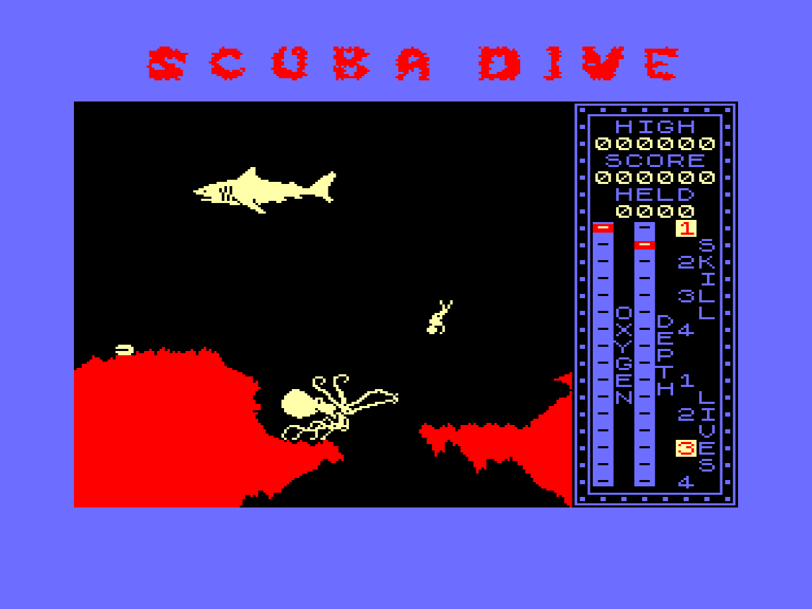

# vector06c-scubadive

Porting **Scuba Dive** game from ZX Spectrum (Durrell Software, 1983) to [Vector-06c](https://en.wikipedia.org/wiki/Vector-06C) (Вектор-06Ц).

The game is for Vector-06C Z80 version ONLY.

Porting status: Released for Vector-06C Z80.

## Source files

The game is assembled with sjasmplus. `scubacod0.asm` is the bootstrap; everything
else is `INCLUDE`d into the main image built from `scubacod1.asm`.

 - **`scubacod0.asm`** — Loader / bootstrap (Intel 8080 mode). Runs at `$0100` on
   start-up: installs the interrupt handler and keyboard/joystick scanning, programs
   the colour palette, decompresses the title screen and the main game code (ZX0)
   into place, then jumps into the game. Exports its symbols via `scubacod0.inc`.
 - **`scubacod0.inc`** — Auto-generated export list (symbol addresses) produced by the
   first pass of `scubacod0.asm`; included by `scubacod1.asm`. Not edited by hand.
 - **`scubacod1.asm`** — Top level of the main game image: cheat switches, program
   entry (title screen + menu), keyboard/joystick decoding, stubs that replace the
   ZX Spectrum ROM calls, and the menu/title strings. Pulls in all the modules below
   and lays out the memory map (charset, mini-map, panel, variables, code).
 - **`scubacoda.asm`** — Game variables / state block at a fixed address (RANDOM seed,
   SCORE, HISCORE, LEVEL, object counts, record-area pointers, etc.).
 - **`scubacodb.asm`** — Core engine, part 1: game-screen rendering (`DrawGameScr`),
   sea-surface and relief drawing, mini-map lookup, char→screen address helpers,
   creature movement/spawn procedures, and the object-record templates plus the
   runtime record buffer. Includes `scubasprt.asm` and `scubarelf.asm`.
 - **`scubacodc.asm`** — Core engine, part 2: the main game loop, the diver (movement,
   collisions, oxygen/depth, lives), HUD/indicators, per-level setup, melodies,
   end-of-game high-score handling, and the menu / attract-mode demo.
 - **`scubasprt.asm`** — Sprite graphics for all moving objects (fish, sharks, octopus,
   diver, boat, …) and, at its tail, the 8×8 relief tiles.
 - **`scubarelf.asm`** — Relief "construction blocks" (each 8×8 tiles) used to build the
   underwater terrain.
 - **`scubammap.asm`** — The world mini-map: a 32×32 grid of relief-block numbers
   describing the whole 256×256-tile world.
 - **`scubapanl.asm`** — The status panel graphic (OXYGEN/DEPTH gauges, SKILL/LIVES,
   score area), stored ZX0-compressed and unpacked to the screen at game start.
 - **`scubasymb.asm`** — Character set / font (ZX Spectrum ROM charset glyphs) for
   on-screen text.

Build / run scripts:

 - **`!compile.cmd`** — Assembles and compresses everything and concatenates the
   result into `scuba.rom`.
 - **`!run-emu80qt.cmd`** — Launches the Emu80 emulator with the built ROM.

## Tools used

 - `sjasmplus.exe` cross-assembler
   https://github.com/z00m128/sjasmplus

 - `salvador.exe` ZX0 compressor
   https://github.com/emmanuel-marty/salvador/releases

 - `Emu80` emulator
   https://emu80.org/ https://github.com/vpyk/emu80v4

## Links

 - [Discussion on zx-pk.ru (in Russian)](https://zx-pk.ru/threads/34605-portirovanie-scuba-dive-na-vektor-z80.html)

